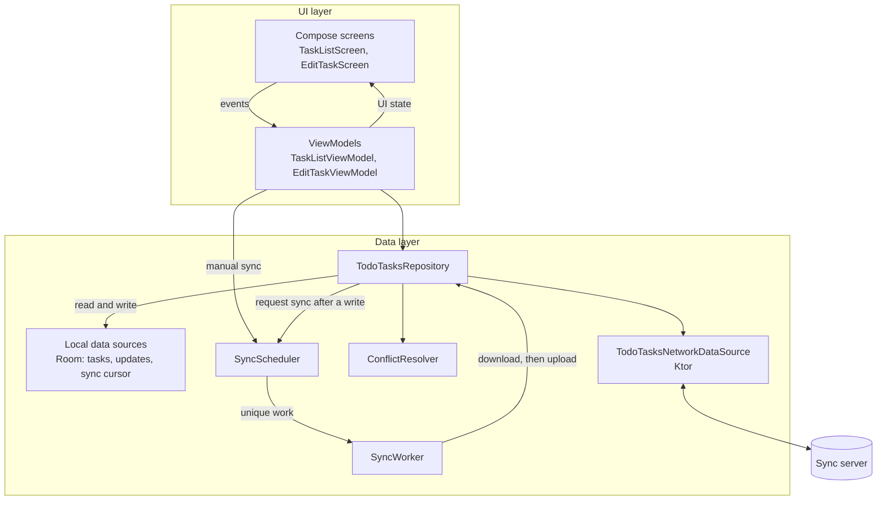
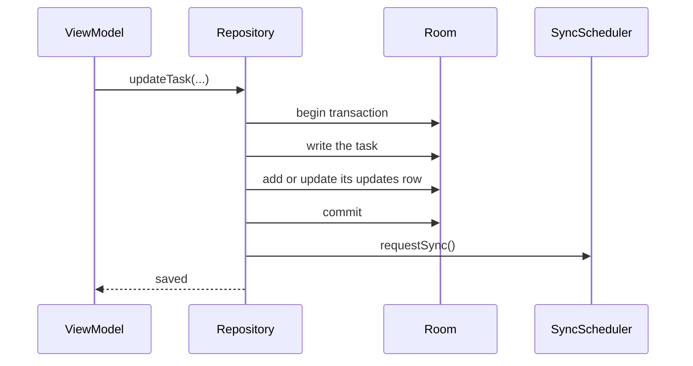

# TodoTasks

TodoTasks is an Android to-do app built to show **offline-first** architecture. You can create, edit, complete, and delete tasks with or without a connection. Every change is saved on the device first. It syncs with a server in the background, and edits made on two devices are merged.

The app is deliberately small, with two screens and one kind of data, so the parts that make it work offline stay easy to follow: the local database, the queue of pending changes, background sync, and conflict resolution.

## Features

- A task list with due dates (Overdue, Today, Tomorrow) and a Completed section
- A form to add, edit, or delete a task, with a title, description, and due date
- Works fully offline. Changes sync when a connection is available.
- Pull to refresh starts a sync right away
- Edits to the same task on two devices are merged field by field
- Unsaved typing in the form survives the app being killed in the background

## Offline-first in brief

The app follows the [offline-first guide](https://developer.android.com/topic/architecture/data-layer/offline-first) on Android Developers, using **lazy writes**:

1. **The local database is the source of truth.** The UI reads only from Room, never from the network, so the app looks and works the same online or offline.
2. **Writes are local and queued.** Each change updates the task and records it in an *updates table* (an outbox) in one transaction. The user's change is saved as soon as that commits.
3. **Sync happens later, in the background.** A WorkManager worker downloads the server's changes, then uploads the queued ones. WorkManager waits for a network connection and retries with backoff when something fails.
4. **Conflicts are merged, not overwritten.** When the server has changed a task that also has local edits, the two versions are merged against the last version both sides agreed on.

## Architecture

The app has a UI layer and a data layer, with no domain layer. There is little business logic beyond what the repository already owns.



### Data layer

| Component | Role |
|---|---|
| `TodoTasksRepository` | The rest of the app's single entry point to task data. Reads come from Room. Writes change the task and queue it in one transaction, then request a sync. It also runs the download and upload steps of a sync. |
| `TodoTasksLocalDataSource` / `TodoTaskSyncLocalDataSource` | Room access for the tasks, and for the updates table and sync cursor. |
| `TodoTasksNetworkDataSource` | The sync server's HTTP API, built with Ktor. Failures are thrown, so the sync worker decides whether to retry. |
| `ConflictResolver` | A three-way merge of the local and server versions of a task against their common base. |
| `SyncScheduler` | Schedules `SyncWorker` as unique WorkManager work, and reports whether a sync is running. |
| `SyncWorker` | Runs a sync, and tells WorkManager whether it succeeded, should be retried, or failed. |

Models are named by where they come from. `NetworkTodoTask` is the server's JSON, `TodoTaskEntity` is the Room row, and `TodoTask` is the model the data layer exposes to the rest of the app. Timestamps are epoch milliseconds.

#### Writing a task



The updates table holds at most one row per task. Each row keeps the task's **base**, which is the last copy synced with the server, and a **revision** that goes up with every local edit. Nothing records which fields changed: comparing the task with its base shows that. A delete is an ordinary edit that sets `deletedAt`. The row is a tombstone that stays until the delete has synced.

#### Syncing

`SyncWorker` runs in two steps.

1. **Download.** It asks the server for every task changed since the last cursor and stores them, together with the new cursor, in one transaction. A task with no local changes takes the server's copy. A task with local changes is merged with the server's copy, and its queued update is rebased onto the server's version.
2. **Upload.** It sends each queued update, oldest first, as a `PUT` with the version its edit was based on.
   - **Accepted:** the server returns the stored task, and its updates row is removed.
   - **Conflict (`409`):** the server's copy is merged with the local one, and the merged result is queued for the next sync.
   - **Edited during the upload:** if the user edited the task while it was uploading, the revision check catches it and the row stays queued, rebased onto the stored version.
   - **Rejected (other `4xx`):** the row is marked failed so it doesn't block the rest of the queue.

Network calls are never made inside a database transaction, so the user's edits are never blocked on the network. Network errors, `5xx` responses, and unreadable responses make the worker retry with WorkManager's exponential backoff.

A sync is requested after every write that changes something, every time the app starts, and when the user pulls to refresh. A pull runs the sync now even if one is waiting out a backoff. A sync that is already running is never started twice.

#### Resolving conflicts

`ConflictResolver` merges `title`, `description`, `dueAt`, and `isComplete` independently.

- **A field changed on one side** keeps that side's change.
- **A field changed on both sides** takes the more recently edited value. On a tie, the server wins.
- **A delete on either side** wins over edits.

So if one device renames a task while another completes it, the merged task is both renamed and completed.

### UI layer

The UI is built with Jetpack Compose and Material 3, with a custom cobalt color scheme for light and dark themes.

- **State flows down, events flow up.** Each ViewModel exposes a single `StateFlow` of a sealed UI state, Loading, Content or Editing, and Error, and receives user actions as function calls.
- **Composables are kept simple.** They render the state they're given and pass events up.
- **Reads that fail show an error state, and writes that fail show a snackbar.** The repository never throws for an invalid request, such as editing a task that no longer exists.
- **Navigation** uses Navigation 3. The back stack is saved, and each screen has its own ViewModel scope.
- **The add and edit form** keeps the user's unsaved draft in `SavedStateHandle`, so it survives process death.
- **Compose stability.** The UI state types are declared stable in `app/compose_stability.conf`, so every composable on both screens can skip recomposition when its inputs haven't changed.

## Tech stack

| Area | Libraries |
|---|---|
| Language | Kotlin, with coroutines and Flow |
| UI | Jetpack Compose, Material 3, Navigation 3 |
| Local storage | Room |
| Networking | Ktor client (OkHttp engine) with kotlinx.serialization |
| Background work | WorkManager |
| Dependency injection | Hilt |
| Testing | JUnit 4, Robolectric, MockK, Turbine, Compose UI tests |

The app targets SDK 37 and runs on Android 12 (API 31) and newer.

## Project structure

```
app/src/main/java/com/harrison/todotasks/
├── data/
│   ├── di/            Hilt modules for networking, time, and WorkManager
│   ├── local/         Room database, DAOs, entities, and local data sources
│   ├── model/         TodoTask, the model the data layer exposes
│   ├── network/       Ktor data source and network models
│   ├── repository/    TodoTasksRepository
│   └── sync/          ConflictResolver, SyncScheduler, SyncWorker
└── ui/
    ├── tasks/         Task list screen, UI state, and ViewModel
    ├── edittask/      Add and edit task screen, UI state, and ViewModel
    ├── navigation/    Navigation 3 setup
    └── theme/         Colors, type, and dimensions
```

## Running the app

The app syncs with a small REST server, which isn't part of this repository. Debug builds expect it at `http://10.0.2.2:8080/`, which is the host machine as seen from the Android emulator. The address is set as `SYNC_BASE_URL` in `app/build.gradle.kts`. Cleartext HTTP is allowed only to the emulator host and `localhost`, and only in debug builds.

The server needs two endpoints.

| Request | Response |
|---|---|
| `GET /tasks?since={cursor}` | `200` with `{ "tasks": [...], "cursor": n }`: every task, tombstones included, whose version is greater than `cursor` |
| `PUT /tasks/{id}` with a task whose `version` is the version it was based on (null for a new task) | `200` with the stored task and its new version, or `409` with the server's task if the server's version has moved on |

Without a server the app still works fully. Changes stay queued, and sync keeps retrying until the server can be reached.

To build and install the debug app on a running emulator or device:

```bash
./gradlew :app:installDebug
```

## Testing

The unit tests run on the JVM, with Robolectric for Room and Compose. They cover the repository's write, upload, download, and conflict paths against a real in-memory Room database, along with the sync worker and scheduler, the ViewModels, and both screens.

```bash
./gradlew :app:testDebugUnitTest
```
